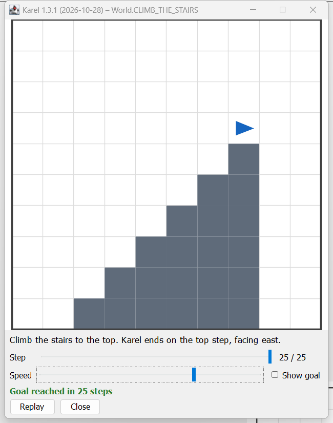
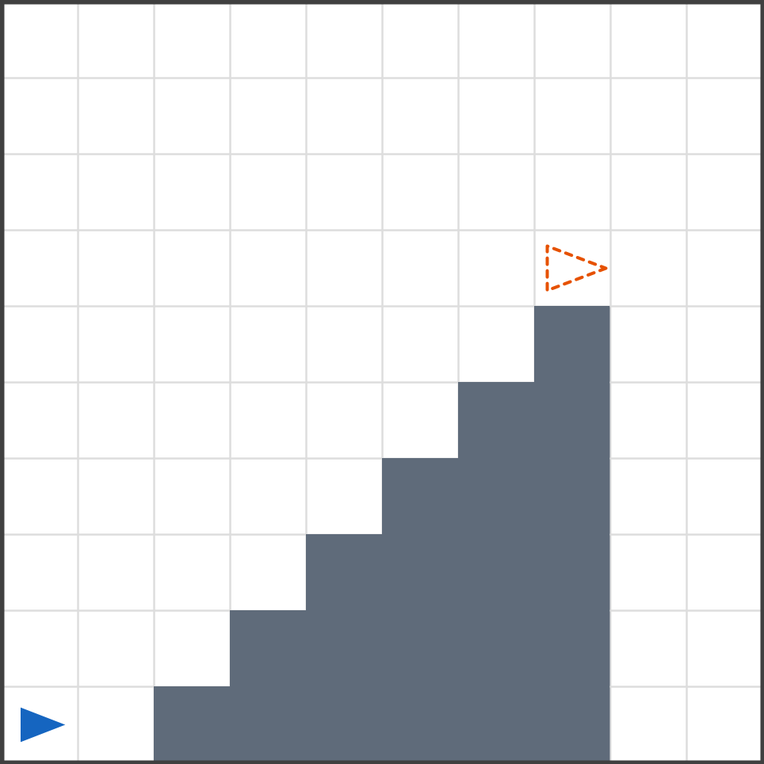

# Karel the Robot on plain Java

Karel is a robot in a grid world. You steer it with a handful of Java commands, and every step is visible in a window. Karel programs are
ordinary Java programs written as compact source files (Java 25: `void main()`, no class needed), so you learn the structure of Java
(methods, loops, conditions, parameters, return values) with something you can see.

Plain Java 25 with Swing, no libraries. Commands and conditions follow [Karel by Fred Overflow](https://github.com/fredoverflow/karel),
the idea goes back to Richard Pattis (1981). For teachers and contributors: `CONTRIBUTING.md`; history: `CHANGELOG.md`.



The program that produced the window on the right, a complete Java file:

```java
import static karel.Karel.*;

void main() {
    openWorld(World.CLIMB_THE_STAIRS);
    moveForward();
    for (int i = 0; i < 6; i++) {
        climbOneStair();
    }
}

void climbOneStair() {
    turnLeft();
    moveForward();
    turnRight();
    moveForward();
}
```

Every command is one visible step. The task text sits under the world, the step slider lets you go back to any step after the run,
and the status line tells whether the goal was reached.

<br clear="all">

## Getting started

1. Download the exercise project `Karel-v1.3.1.zip` from the [releases](https://github.com/koppor/karel-on-plain-java/releases) (or from wherever your course hands it out); it contains the engine, all worlds and a first program.
2. Unpack it. Windows: click the ZIP once, then **Extract all** in the Explorer toolbar (or right-click, Extract all). macOS: the browser
   unpacks it after the download; the folder `Karel-v1.3.1` is in Downloads.
3. IntelliJ: Main Menu (four lines), **File, Open**, select the extracted **folder** `Karel-v1.3.1` (not a file inside it). Trust Project with the
   Defender option unticked. If IntelliJ asks for a JDK: Setup SDK, choose JDK 26 (Download JDK if the list is empty).
4. Open `src/FirstKarelProgram.java` and run it with the green arrow next to `void main()`. The Karel window opens.
5. One file per task: click `FirstKarelProgram.java`, Ctrl+C, click `src`, Ctrl+V, name it after the world (for example `CarryTheHarvest.java`),
   change the world in `openWorld(...)`.

Every task is in its own world, every world is one line: `openWorld(World.CARRY_THE_HARVEST);`. Type `World.` and press Ctrl+Space to see them all.
The task text is shown under the world and in the Run window.

## Commands, conditions, sonar

| Commands (Karel does something)                                   | Conditions (true or false)                               | Sonar (a number)                                                       |
| ----------------------------------------------------------------- | -------------------------------------------------------- | ---------------------------------------------------------------------- |
| `moveForward();` one cell forward                                 | `frontIsClear()` no wall in front                        | `distanceToWall()` moves possible before the wall, 0 if it is in front |
| `turnLeft();` 90° counterclockwise                                | `leftIsClear()` no wall to the left                      | `distanceToBeeper()` moves to the next beeper ahead, −1 if none        |
| `turnRight();` 90° clockwise                                      | `rightIsClear()` no wall to the right                    |                                                                        |
| `turnAround();` 180°                                              | `onBeeper()` at least one beeper on this cell            |                                                                        |
| `pickBeeper();` take one beeper from this cell                    | `beeperAhead()` at least one beeper on the cell in front |                                                                        |
| `dropBeeper();` put one beeper on this cell (any number per cell) |                                                          |                                                                        |

Errors stop the program with a message in the Run window, for example "Karel cannot move forward: wall ahead"; click the link to jump to the line.

## The window

- **Step** slider: follows the run; after the end drag it to see the world after any step.
- **Speed** slider: the pause between steps.
- **Show goal**: the goal as an orange outline.
- Status line: "Goal reached in n steps", or what is still wrong, or the error.
- **Replay** plays the run again; **Close** ends the program.

## Worlds and tasks



Every world has a start and a goal. **Show goal** draws the goal as an orange outline into the current world, here for `CLIMB_THE_STAIRS`:
Karel has to end on the top step, facing east.

Tasks keep their numbers across the course (basics: 1 to 6; methods with parameters and return values: 10 to 12; advanced: 13 to 16). Worlds marked "random" are different on
every run; your program must work for all.

| Task  | World                 | What to do                                                                                                                           |
| ----- | --------------------- | ------------------------------------------------------------------------------------------------------------------------------------ |
| 1     | `OBTAIN_ARTIFACT`     | The artifact lies behind the pillar. Fetch it and bring it back to where Karel started.                                              |
| 2     | `DEFUSE_ONE_BOMB`     | A bomb lies at the other wall. Pick it up and carry it back to the start.                                                            |
| 3     | `CLIMB_THE_STAIRS`    | Climb the stairs to the top. Karel ends on the top step, facing east.                                                                |
| 4     | `FILL_THE_HOLES`      | Drop one beeper into each of the four holes, then walk on.                                                                           |
| 5     | `HANG_THE_LAMPIONS`   | Ten lampions lie on the floor. Hang each one directly under the ceiling; the heights differ on every run (random).                   |
| 6     | `WALK_THE_LABYRINTH`  | Follow the corridor to its end and pick up the diamond. The corridor is new on every run (random).                                   |
| extra | `MOW_THE_LAWN`        | Pick up all 36 beepers, row by row, like mowing a lawn.                                                                              |
| extra | `DEFUSE_TWO_BOMBS`    | Two bombs, one at each wall. Defuse both: call defuseOneBomb twice.                                                                  |
| extra | `PRACTICE_HOME_RUN`   | Pick up the beepers in all four corners and return home.                                                                             |
| extra | `SAVE_THE_FLOWER`     | Carry the flower to the top of the mountain and climb down on the other side.                                                        |
| extra | `STEAL_OLYMPIC_FIRE`  | Climb the stairs, take the fire, and jump down on the far side.                                                                      |
| 10    | `FIND_THE_CENTER`     | Find the middle of the corridor and drop a beeper there. The length is odd and changes on every run (random).                        |
| 11    | `CARRY_THE_HARVEST`   | Collect all beepers on the way to the east wall and drop them there as one stack. Their number changes on every run (random).        |
| 12    | `COPY_THE_TOWER`      | Karel stands on a tower of beepers. Build a tower of the same height at the east wall; the first tower stays (random).               |
| 13    | `FETCH_THE_BEEPER`    | One beeper lies ahead at an unknown distance. Bring it back to the start; Karel ends facing west (random).                           |
| 14    | `BUILD_THE_STAIRCASE` | Build stacks of 1, 2, 3, ... 9 beepers on the nine cells ahead and stop on the last one.                                             |
| 15    | `COLLECT_THE_STACKS`  | Three stacks of beepers lie in the corridor. Collect all and drop the total as one stack at the east wall (random).                  |
| 16    | `FENCE_THE_FIELD`     | Put a beeper on every border cell of the square field and return to the corner, facing east. The size changes on every run (random). |

## Own worlds

Since Karel 1.3.0 you can draw your own world in the program, as two text blocks: the start and the goal. Same characters as above:
`.` empty, `*` one beeper, `2` to `9` that many, `#` wall, `>` `^` `<` `v` Karel facing east, north, west, south, `E` `N` `W` `S` Karel on a beeper.

```java
import static karel.Karel.*;

void main() {
    openWorld("""
            ......
            >..*..
            """, """
            ......
            ...E..
            """);
    moveForward();
    moveForward();
    moveForward();
}
```

All rows must have the same length, exactly one Karel, and start and goal the same size. `openWorld(start)` with one map only runs
without a goal check. Share a world with others by sharing the two text blocks.

## Typical problems

| Message or symptom                                            | Fix                                                                                                                                                                                 |
| ------------------------------------------------------------- | ----------------------------------------------------------------------------------------------------------------------------------------------------------------------------------- |
| `package karel does not exist`                                | the wrong folder is open: File, Open, select the extracted folder itself                                                                                                            |
| `Project JDK is not defined`                                  | click Setup SDK, choose JDK 26                                                                                                                                                      |
| `cannot find symbol: openWorld`                               | first line missing: `import static karel.Karel.*;`                                                                                                                                  |
| `cannot find symbol: moveForward` after writing an own method | your method is named like a Karel command (for example `moveForward(int steps)`); rename it, for example `move`                                                                     |
| another program runs                                          | use the green arrow next to `void main()` in the open file                                                                                                                          |
| the program does not end                                      | click Close in the Karel window                                                                                                                                                     |
| Ctrl+Alt+L indents methods by 8 extra spaces                  | IntelliJ bug [IDEA-382349](https://youtrack.jetbrains.com/issue/IDEA-382349) with compact source files: Settings, Editor, Code Style, Java, Tabs and Indents, Continuation indent 0 |

## Credits

Karel the Robot was invented by Richard E. Pattis (Stanford University, 1981). Commands, conditions and eleven of the worlds follow
[Karel by Fred Overflow](https://github.com/fredoverflow/karel), which is free software; every such world links to its source line in his
[`Problem.kt`](https://github.com/fredoverflow/karel/blob/9cb021de0a4d778346b54cdfac68bd46ab4dadde/src/main/kotlin/logic/Problem.kt) in the
engine. Fred Overflow has no affiliation with this project; following his
[conditions](https://github.com/fredoverflow/karel/issues/4#issuecomment-1110291077), sample solutions are not published.
Licence: MIT (`LICENSE`).
